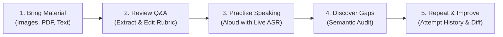
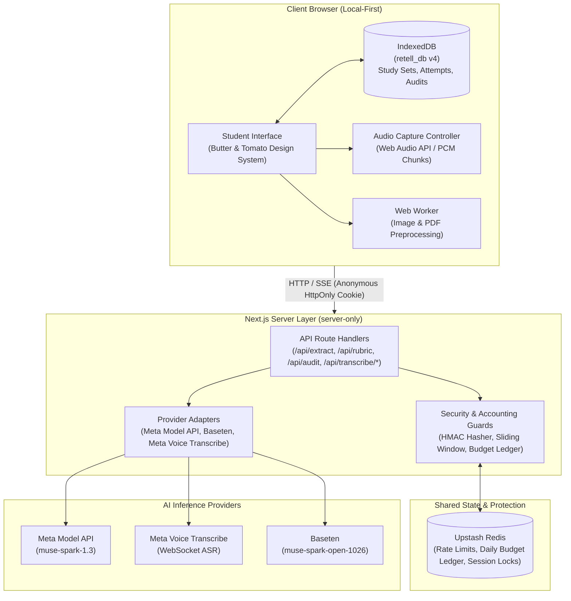

# Retell

> **Know it. Say it. Improve it.**

**Live Application:** [https://retell-five.vercel.app/](https://retell-five.vercel.app/)

[](LICENSE)
[](https://nextjs.org/)
[](https://react.dev/)
[](https://www.typescriptlang.org/)
[](https://tailwindcss.com/)

Retell is an AI-powered exam answer practice platform that helps students practise explaining answers in their own words, identify missing concepts, and improve through repeated attempts.

- **Live Application:** [https://retell-five.vercel.app/](https://retell-five.vercel.app/)
- **Repository:** [https://github.com/kaushik0010/retell](https://github.com/kaushik0010/retell)

---

## The Problem

Students often memorise textbook answers and lecture notes but struggle to reproduce them accurately during examinations. When faced with an exam prompt, a student may understand the underlying topic conceptually yet omit critical technical terms, causal relationships, sequential steps, or required evidence expected in written answers.

Conventional study techniques rarely address spoken explanation:

- **Passive rereading** produces an illusion of mastery without active retrieval practice.
- **Flashcard applications** test isolated atomic facts rather than structured, multi-sentence conceptual explanations.
- **Generic chat assistants** often drift from the student's specific syllabus or compare answers through naive keyword matching, penalising valid paraphrases or accepting superficial buzzwords without substance.

Retell bridges this gap by enabling students to practise answering aloud, comparing their spoken explanations against their actual source materials to highlight what was covered, what was missed, and what was inaccurate.

---

## How Retell Works

Retell structures the study and practice journey into five steps focused on extracting and mastering existing questions and answers from supplied course materials:



1. **Bring your study material**
   - Upload handwritten or printed notes as images (PNG, JPEG, WebP).
   - Upload course materials, question banks, or textbook excerpts as PDFs.
   - Paste existing question-and-answer pairs directly into the editor.
2. **Review your material**
   - Extract source-grounded questions and reference answers using multimodal AI.
   - Review, edit, and refine the extracted content in the browser.
   - Inspect automatically identified key points, required terminology, and evaluation criteria grounded in the source text.
3. **Practise speaking**
   - Practise answering aloud naturally using browser audio capture.
   - Receive live, real-time speech transcription streamed directly as you speak.
   - Receive contextual, non-intrusive recall hints if you pause for an extended period.
4. **Discover what you missed**
   - Evaluate your spoken answer against the reference answer using semantic reasoning.
   - Identify which key concepts were covered, partially covered, missing, or inaccurate.
   - Receive actionable feedback distinguishing omitted points from factual misconceptions.
5. **Improve through repetition**
   - Practise the whole answer or drill individual paragraphs in isolation.
   - Track progress over time across multiple attempts in your local study library.
   - Compare attempts side-by-side to verify concept retention and identify newly introduced errors.

> **Note on Question Extraction:** Retell focuses on identifying and structuring _existing_ study questions and reference answers provided in your course material, rather than inventing ungrounded questions from raw notes.

---

## Features

### Material Ingestion & Processing

- **Multiple Input Formats:** Ingest study materials from pasted text, camera captures, scanned images, and multi-page PDF documents.
- **Client-Side Image Optimization:** Automatically scales and compresses image uploads using Web Workers (`browser-image-compression`), preserving legibility of handwriting, diagrams, and formulas while enforcing payload safety.
- **Intelligent PDF Ingestion:** Inspects and previews PDF pages client-side using `pdfjs-dist`, offering page selection, layout previews, and payload budget estimation before extraction.
- **Payload Protection:** Client-side upload budget meter enforcing safe payloads below standard hosting limits.

### Source Review & Rubric Extraction

- **Source-Grounded Extraction:** AI-powered extraction parses questions, reference answers, and key concepts strictly grounded in the supplied document.
- **Editable Material Review:** Full in-browser editor allowing students to adjust question prompts, correct reference text, and refine key evaluation criteria before practising.
- **Concept Decomposition:** Breaks complex reference answers into discrete, testable concepts with assigned criteria, required terminology, and supporting details.

### Spoken Practice & Real-Time ASR

- **Spoken Active Recall:** Rehearse answers aloud using standard microphone input.
- **Low-Latency Streaming ASR:** Real-time speech transcription powered by server-relay WebSocket connections to Meta Voice Transcribe, with seamless browser `SpeechRecognition` fallback.
- **Flexible Practice Scopes:** Choose between whole-answer practice or focused paragraph-level practice for long, multi-stage answers.
- **Contextual Recall Hints:** Automatically surfaces gentle recall prompts during extended silence without prematurely penalising unanswered concepts.

### Semantic Evaluation & Progress Tracking

- **Semantic Answer Auditing:** Evaluates spoken explanations against the source rubric using meaning-based reasoning, accommodating synonyms, natural paraphrasing, and varying sentence structures.
- **Misconception vs. Omission Separation:** Clearly distinguishes points that were simply omitted from statements that were factually incorrect or unclear.
- **Actionable Review Cards:** Categorises evaluation into _What you got right_, _Missing or incomplete_, and _Incorrect or unclear_ with cited transcript evidence.
- **Attempt History & Timeline:** Revisit past attempts with duration metrics, word counts, concept coverage badges, and timestamps.
- **Attempt Comparison Engine:** Compares two attempts side-by-side to track concept transitions (_Maintained_, _Improved_, _Still Missing_, or _Regressed_).

### Privacy & Resource Safeguards

- **Local-First Architecture:** Study sets, rubrics, audio transcripts, and attempt evaluations persist in the browser's IndexedDB without mandatory user registration.
- **Anonymous Rate Limiting:** Persistent multi-tiered sliding-window rate limiting protecting shared AI endpoints against abuse.
- **Global Spending Protection:** Server-side budget ledger enforcing daily USD spending ceilings with integer micro-USD precision and atomic reservation.
- **Fail-Closed Security:** Paid AI routes fail closed in production if security services are unreachable, preventing uncontrolled resource consumption.

---

## Technology Stack

| Layer                      | Technology                                          | Purpose in Retell                                                              |
| :------------------------- | :-------------------------------------------------- | :----------------------------------------------------------------------------- |
| **Framework**              | Next.js 16.4.3 (App Router)                         | Server-rendered shell, API route handlers, and static optimization             |
| **UI Library**             | React 19.3.0                                        | Component rendering and client-side state management                           |
| **Language**               | TypeScript 5.9.3 (Strict)                           | End-to-end type safety across domain models and API contracts                  |
| **Styling**                | Tailwind CSS v4.3.3                                 | Design-token-driven responsive styling (_Butter & Tomato_ palette)             |
| **Validation**             | Zod 4.6.7                                           | Runtime schema validation for rubrics, audits, and API payloads                |
| **Local Persistence**      | Browser IndexedDB                                   | Client-side database (`retell_db` v4) storing study sets, attempts, and audits |
| **Image Compression**      | `browser-image-compression` 2.0.2                   | Web Worker image optimization prior to server extraction                       |
| **PDF Processing**         | `pdfjs-dist` 4.10.38                                | Client-side PDF page rendering, page previews, and text extraction             |
| **Primary Reasoning**      | Meta Model API (`muse-spark-1.3`)                   | Q&A extraction, rubric generation, and semantic answer auditing                |
| **Alternative Reasoning**  | Baseten (`meta-models/muse-spark-open-1026`)        | Supported fallback provider for text reasoning and semantic auditing           |
| **Speech Recognition**     | Meta Voice Transcribe (`muse-voice-transcribe-1.0`) | Low-latency real-time ASR WebSocket relay with browser fallback                |
| **Rate Limiting & Budget** | Upstash Redis (`@upstash/redis` 1.40.0)             | Persistent sliding-window rate limiting and daily AI budget ledger             |
| **Testing**                | Vitest 5.0.5                                        | Fast unit and integration test runner for domain, accounting, and UI logic     |

---

## Architecture & Privacy

Retell is engineered with a local-first philosophy, balancing browser-side privacy with protected server-side AI execution:



### Local-First Storage

- **No Mandatory Account:** Students can create study sets, record spoken attempts, and track evaluations without creating an account or providing personal details.
- **Browser-Side Persistence:** All study materials, extracted rubrics, and attempt histories are persisted in browser IndexedDB (`retell_db`).
- **No Cloud Synchronization:** Retell does not synchronise your study sets to any third-party database. Clearing browser storage, using private browsing windows, or switching devices will reset your locally stored study sets.

### AI Processing Boundaries

- **Server-Side API Credentials:** All AI provider keys and credentials remain strictly server-side (`server-only`). Client bundles never receive or execute API keys.
- **Provider Data Transmission:** Study excerpts, reference answers, and spoken audio transcripts are transmitted securely from your browser to Retell's server-side API routes, which relay them to the configured AI provider (Meta or Baseten) to generate rubrics and perform semantic evaluations. Retell does not perform full AI inference locally on device.

### Abuse Protection & Resource Governance

- **Anonymous Device Identification:** Devices receive a randomly generated UUIDv4 stored in a secure `HttpOnly`, `SameSite=Lax` cookie (`retell_device_id`). The server hashes this identifier using a server-side HMAC secret before querying rate limits. No personally identifiable information (PII) or raw IP addresses are ever stored in Redis keys.
- **Persistent Sliding-Window Rate Limiting:** Prevents automated abuse via multi-tiered rate limits (burst and sustained limits across device and IP identifiers).
- **Daily Budget Cap:** Enforces an operator-defined global daily spending limit in USD (`RETELL_DAILY_BUDGET_USD`). Two-phase atomic budget reservation prevents cloud cost overruns.
- **Fail-Closed Policy:** In production mode, paid AI routes fail closed (HTTP 503) if Redis is unavailable or unconfigured, preventing unmetered spending spikes.

---

## Getting Started

### Prerequisites

Ensure the following tools are installed on your machine:

- **Node.js:** `v20.x` or `v22.x` (recommended: `v22.21.0` or higher)
- **pnpm:** `v10.x` or `v11.x` (`v11.0.9` configured via `packageManager`)
- **Git:** `v2.40+`

### Installation

1. Clone the repository:

   ```bash
   git clone https://github.com/kaushik0010/retell.git
   cd retell
   ```

2. Install dependencies:
   ```bash
   pnpm install
   ```

---

## Environment Configuration

Create a local environment file by copying the provided template:

**Linux / macOS (Bash):**

```bash
cp .env.example .env.local
```

**Windows (PowerShell):**

```powershell
Copy-Item .env.example .env.local
```

### Documented Environment Variables

| Variable                                | Purpose                                                        | Status                                                 | Source / Provider                               | Security Scope                      |
| :-------------------------------------- | :------------------------------------------------------------- | :----------------------------------------------------- | :---------------------------------------------- | :---------------------------------- |
| `NODE_ENV`                              | Sets runtime environment (`development`, `test`, `production`) | Required                                               | Node.js Runtime                                 | Server-side                         |
| `META_MODEL_API_KEY`                    | Bearer token for Meta Model API reasoning & ASR                | Required for Meta                                      | [Meta AI Developer Portal](https://api.meta.ai) | **Server-side only** (Never commit) |
| `META_REASONING_MODEL`                  | Model ID for text reasoning and extraction                     | Optional (default: `muse-spark-1.3`)                   | Meta Model API                                  | Server-side                         |
| `META_TRANSCRIPTION_MODEL`              | Model ID for real-time speech transcription                    | Optional (default: `muse-voice-transcribe-1.0`)        | Meta Voice Transcribe                           | Server-side                         |
| `BASETEN_API_KEY`                       | API token for Baseten alternative reasoning                    | Required if using Baseten                              | [Baseten Console](https://baseten.co)           | **Server-side only** (Never commit) |
| `BASETEN_REASONING_MODEL`               | Model ID for Baseten reasoning                                 | Optional (default: `meta-models/muse-spark-open-1026`) | Baseten Model Hub                               | Server-side                         |
| `REASONING_PROVIDER`                    | Active reasoning provider (`meta` or `baseten`)                | Optional (default: `meta`)                             | Retell Configuration                            | Server-side                         |
| `TRANSCRIPTION_PROVIDER`                | Active speech transcription provider (`meta`)                  | Optional (default: `meta`)                             | Retell Configuration                            | Server-side                         |
| `UPSTASH_REDIS_REST_URL`                | Upstash Redis REST endpoint URL                                | Required in production                                 | [Upstash Console](https://console.upstash.com)  | Server-side                         |
| `UPSTASH_REDIS_REST_TOKEN`              | Upstash Redis REST authentication token                        | Required in production                                 | [Upstash Console](https://console.upstash.com)  | **Server-side only** (Never commit) |
| `RETELL_DAILY_BUDGET_USD`               | Global aggregate daily spending cap in USD                     | Optional (default: `30.00`)                            | Operator Policy                                 | Server-side                         |
| `RETELL_ANONYMOUS_HMAC_SECRET`          | 32+ char secret for hashing device IDs and IPs                 | Optional in dev; recommended in prod                   | Random Secret                                   | **Server-side only** (Never commit) |
| `RETELL_PRICE_PER_1M_INPUT_TOKENS_USD`  | Unit cost override for input tokens ($)                        | Optional (default: `1.25`)                             | Billing Override                                | Server-side                         |
| `RETELL_PRICE_PER_1M_OUTPUT_TOKENS_USD` | Unit cost override for output tokens ($)                       | Optional (default: `4.25`)                             | Billing Override                                | Server-side                         |
| `RETELL_PRICE_PER_AUDIO_MINUTE_USD`     | Unit cost override for speech audio ($)                        | Optional (default: `0.012`)                            | Billing Override                                | Server-side                         |

### Hackathon Testing Budget & Pricing Defaults

For the hackathon testing period, Retell uses the following application-side accounting defaults to provide ample headroom so evaluators do not encounter premature rate-limiting or budget-exhaustion errors while testing:

```env
RETELL_DAILY_BUDGET_USD=30.00
RETELL_PRICE_PER_1M_INPUT_TOKENS_USD=1.25
RETELL_PRICE_PER_1M_OUTPUT_TOKENS_USD=4.25
RETELL_PRICE_PER_AUDIO_MINUTE_USD=0.012
```

These values represent Retell's internal application-side accounting and safety ceiling defaults for the hackathon testing period. They are not necessarily the actual billing rates charged by Meta or Baseten.

### Local Development vs. Production

- **Local Development:** When Upstash Redis variables are omitted in local development, Retell automatically falls back to an in-memory accounting and rate-limiting simulator so you can test features without cloud dependencies.
- **Production:** In production (`NODE_ENV=production`), Upstash Redis credentials are required. Retell employs a fail-closed architecture to prevent unmetered AI usage if Redis is unreachable.

> **Security Reminder:** Never commit `.env.local`, `.env`, or real API credentials to source control. Secret credentials must remain server-side and are strictly ignored by `.gitignore`.

---

## Running the Application

Start the local development server:

```bash
pnpm run dev
```

Open your browser and navigate to:

```
http://localhost:3000
```

To run a production build locally:

```bash
pnpm run build
pnpm run start
```

---

## Testing Retell with Sample Study Materials

To simplify evaluation, judges and evaluators do not need to find external textbooks, draft sample questions, or prepare study materials from scratch.

Two curated sample PDF documents are included directly in the repository under [`public/assets/qa_material/`](public/assets/qa_material):

| Sample File                                                                                                        |   Size   | Pages | Description & Purpose                                                                                                                                                                                                                                                                                                                                  |
| :----------------------------------------------------------------------------------------------------------------- | :------: | :---: | :----------------------------------------------------------------------------------------------------------------------------------------------------------------------------------------------------------------------------------------------------------------------------------------------------------------------------------------------------- |
| [`AI_ML_Module_2_Questions_with_Answers.pdf`](public/assets/qa_material/AI_ML_Module_2_Questions_with_Answers.pdf) | ~150 KB  |   6   | **Fast First Test (Digital Q&A):** Clean digital text covering Artificial Intelligence & Machine Learning (Module 2: Search Strategies, Depth-First Search, and Heuristic evaluation). Ideal for quickly testing end-to-end question extraction, rubric generation, and spoken practice in under two minutes without upload wait times.                |
| [`STE_QB_UT1.pdf`](public/assets/qa_material/STE_QB_UT1.pdf)                                                       | ~1.59 MB |  14   | **Substantial Ingestion & Preparation Test (Scanned Question Bank):** Authentic scanned engineering question bank containing 24 questions and answers on Software Testing / Engineering (Unit Test 1). Ideal for evaluating local PDF preview rendering, upload payload estimation, multi-question preparation recovery, and paragraph-level practice. |

### How to Test with Sample PDFs

1. **Download a sample PDF:**
   - From GitHub: Navigate to [`public/assets/qa_material/`](public/assets/qa_material) and download either [`AI_ML_Module_2_Questions_with_Answers.pdf`](public/assets/qa_material/AI_ML_Module_2_Questions_with_Answers.pdf) or [`STE_QB_UT1.pdf`](public/assets/qa_material/STE_QB_UT1.pdf).
   - Alternatively, when running locally or on the live application ([https://retell-five.vercel.app/](https://retell-five.vercel.app/)), both files are served as static assets from `/assets/qa_material/<filename>`.
2. **Upload the file into Retell:**
   - Navigate to **Add study material** (`/materials/new`) from the top navigation.
   - Switch to the **Upload PDF Document** tab and select the downloaded PDF.
3. **Inspect the document & extract:**
   - For multi-page files, verify the instant client-side page preview and payload budget meter.
   - Click **Extract Questions & Answers** to run source-grounded multimodal extraction.
4. **Review & prepare points to remember:**
   - Review the extracted questions, reference answers, and page sources.
   - Click **Save and prepare** to generate key conceptual rubrics (main ideas, key terms, sequences, and pitfalls to avoid). If a transient timeout occurs on a large file, the preparation recovery banner preserves your extracted content and completed questions so you can resume without re-uploading.
5. **Practise and review:**
   - Open the study set and click **Start Practising** for any question.
   - Choose between **Whole answer** practice or focused **Paragraph-level** practice.
   - Speak your answer aloud with real-time speech transcription, inspect your conceptual gaps in the Answer Review, and track your progress across multiple attempts with side-by-side Attempt Comparison.

---

## Running Tests

Retell includes a comprehensive test suite covering domain logic, accounting guards, rate limiters, audio accumulators, and file preprocessing:

```bash
# Run all unit and integration tests (Vitest)
pnpm run test

# Validate TypeScript types without emitting JavaScript
pnpm run type-check

# Run ESLint static code quality checks
pnpm run lint

# Verify code formatting with Prettier
pnpm run format:check

# Run production Webpack compilation
pnpm run build

# Run live provider smoke test (requires .env.local with valid API keys)
pnpm run test:providers
```

### What Each Check Validates

- **`pnpm run test`:** Executes 313 unit and integration tests across 34 test files with zero failures, including paragraph scope isolation, rate limit sliding windows, budget reservation lifecycles, and PDF extraction.
- **`pnpm run type-check`:** Runs `tsc --noEmit` across all application routes, domain models, and test files with strict type constraints.
- **`pnpm run lint`:** Enforces ESLint 9 rules with Next.js flat configuration.
- **`pnpm run format:check`:** Verifies Prettier code style and Tailwind CSS class ordering.
- **`pnpm run build`:** Verifies that Next.js successfully compiles and optimizes all 19 application routes for production deployment.

---

## Project Structure

```
retell/
├── docs/                           # Project documentation and specifications
│   ├── ARCHITECTURE.md             # System boundaries and architecture specs
│   ├── DECISIONS.md                # Architecture Decision Records (ADRs)
│   ├── IMPLEMENTATION_PLAN.md      # Structural architecture and component guide
│   ├── PROGRESS.md                 # Real-time task tracking and verification log
│   └── ROADMAP.md                  # Milestone roadmap and delivery checklist
├── public/                         # Static public assets (icons, worker scripts, samples)
│   ├── assets/                     # UI illustrations and sample question banks
│   └── pdf.worker.min.mjs          # Client-side PDF.js worker bundle
├── src/
│   ├── app/                        # Next.js App Router (pages and API route handlers)
│   │   ├── api/                    # Server-side API endpoints
│   │   │   ├── audit/              # Semantic answer evaluation endpoint
│   │   │   ├── extract/            # Multimodal Q&A extraction endpoint
│   │   │   ├── rubric/             # Key points & rubric generation endpoint
│   │   │   └── transcribe/         # Real-time ASR session, audio & SSE stream routes
│   │   ├── icon.svg                # Programmatic SVG favicon (Butter & Tomato brand)
│   │   ├── layout.tsx              # Root HTML shell, brand typography, and metadata
│   │   └── page.tsx                # Retell landing and onboarding page
│   ├── components/                 # Shared UI components and primitives
│   │   ├── ui/                     # Design system atoms (buttons, cards, badges)
│   │   └── AppShell.tsx            # Application shell with responsive sidebar navigation
│   ├── features/                   # Domain-colocated UI feature modules
│   │   ├── answer-review/          # Semantic audit cards, gap analysis, and recommendations
│   │   ├── attempts/               # Attempt history timeline and comparison views
│   │   ├── home/                   # Hero section, quick-start presets, and onboarding
│   │   ├── library/                # Local study library and study set management
│   │   ├── materials/              # File upload, PDF preview, and extraction views
│   │   ├── practice/               # Practice room, live waveform, transcript, and pause hints
│   │   └── source-review/          # Q&A inspection, key points editor, and rubric setup
│   └── lib/                        # Core utilities, services, and domain models
│       ├── accounting/             # Rate limiting, anonymous device ID, and budget ledger
│       ├── audit/                  # Semantic evaluation engine and scoring rubrics
│       ├── audio/                  # Audio capture controller and transcript accumulator
│       ├── domain/                 # Zod schemas and TypeScript domain entities
│       ├── files/                  # Client-side image optimization and PDF extractor
│       ├── providers/              # Provider adapters for Meta Model API and Baseten
│       └── storage/                # Local IndexedDB persistence store (retell_db v4)
├── tests/                          # Automated test suites
│   ├── fixtures/                   # Deterministic sample audio and document fixtures
│   └── unit/                       # 34 Vitest unit and integration test files
├── .env.example                    # Template for environment configuration
├── LICENSE                         # MIT License
├── package.json                    # Dependencies, scripts, and runtime configuration
└── tsconfig.json                   # Strict TypeScript compiler configuration
```

---

## Current Project Status

- **Ingestion & Extraction:** Verified with image, PDF, and text inputs; multimodal question and answer extraction operational.
- **Rubric Generation:** Verified source-grounded key point breakdown with required terminology and scoring criteria.
- **Practice Room & Transcription:** Verified live spoken recording via Meta Voice Transcribe WebSocket relay with browser audio capture and fallback.
- **Semantic Evaluation:** Verified concept auditing with paragraph-level scope isolation and misconception separation.
- **History & Comparison:** Verified attempt tracking, IndexedDB persistence (`retell_db` v4), and side-by-side attempt comparison.
- **Resource Protection:** Verified anonymous device identification, sliding-window rate limiting, and global budget protection.
- **Quality Verification:** 313 unit and integration tests passing; zero TypeScript errors; production build verified across 19 routes.
- **Deployment Status:** Production application deployed on Vercel at [https://retell-five.vercel.app/](https://retell-five.vercel.app/).

---

## Contributing

Contributions that align with Retell's mission of student-focused spoken active recall, source grounding, and local-first architecture are welcome:

1. **Fork the repository** on GitHub: [https://github.com/kaushik0010/retell](https://github.com/kaushik0010/retell)
2. **Create a feature branch:**
   ```bash
   git checkout -b feature/my-improvement
   ```
3. **Implement your changes** and maintain test coverage.
4. **Add or update tests** in `tests/unit/`.
5. **Run the quality check suite:**
   ```bash
   pnpm run test
   pnpm run type-check
   pnpm run lint
   pnpm run format:check
   pnpm run build
   ```
6. **Open a Pull Request** describing your changes and verification results.

---

## Acknowledgements

- **[Meta AI](https://api.meta.ai):** Built for the Meta Global AI Developer Hackathon, leveraging the Meta Model API (`muse-spark-1.3`) for multimodal reasoning and Meta Voice Transcribe (`muse-voice-transcribe-1.0`) for real-time speech recognition.
- **[Baseten](https://baseten.co):** Supported alternative reasoning provider via `meta-models/muse-spark-open-1026`.
- **[Upstash](https://upstash.com):** Serverless Redis for persistent sliding-window rate limiting and global budget protection.
- **Open-Source Community:** Powered by [Next.js](https://nextjs.org), [React](https://react.dev), [Tailwind CSS](https://tailwindcss.com), [Zod](https://zod.dev), [Vitest](https://vitest.dev), [PDF.js](https://mozilla.github.io/pdf.js/), and [`browser-image-compression`](https://github.com/Donaldcwl/browser-image-compression).

---

## License

Retell is open-source software licensed under the [MIT License](LICENSE).
